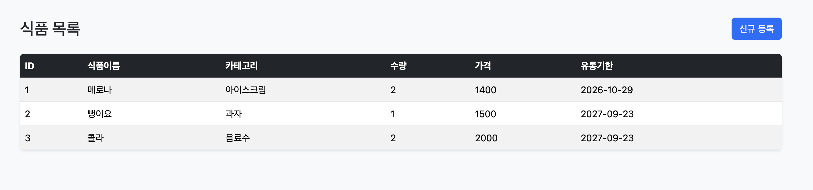
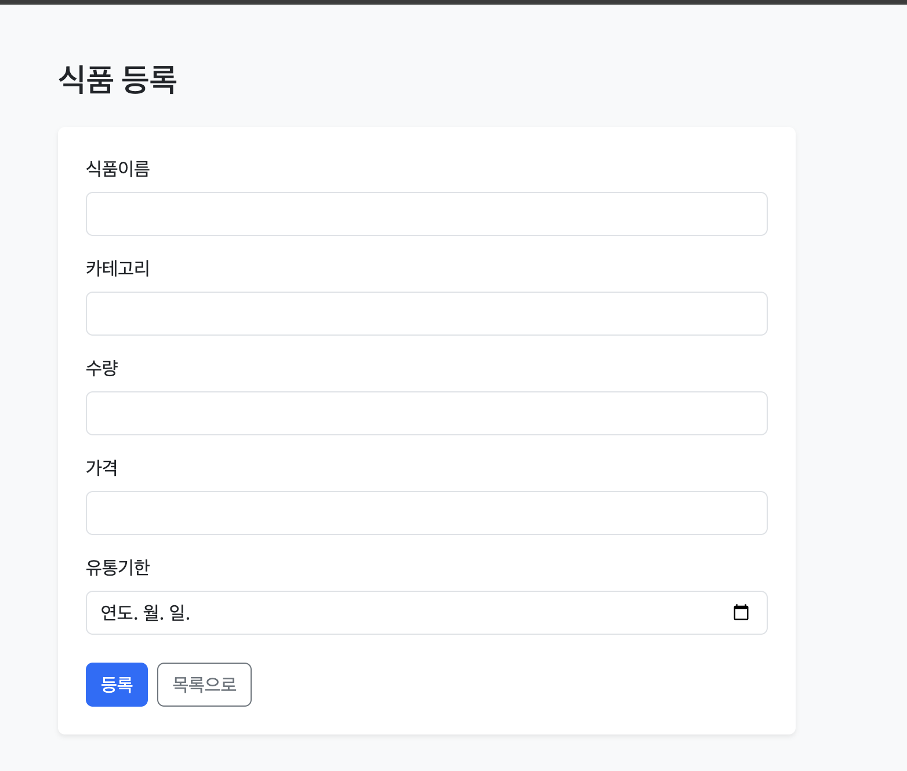

# 식품 관리 서비스 (Spring Boot + Thymeleaf)

4주차 Memory 기반 CRUD 프로젝트를 확장하여, Thymeleaf로 화면을 만들고 HTML Form으로 데이터를 등록하는 웹 애플리케이션입니다.

## ① 프로젝트 소개

### 프로젝트 주제

**식품 관리 서비스**: 식품의 이름, 카테고리, 수량, 가격, 유통기한을 등록하고 목록으로 확인합니다.

| 필드 | 타입 | 설명 |
|---|---|---|
| id | Long | 1부터 자동 증가 |
| name | String | 식품이름 |
| category | String | 카테고리 |
| quantity | int | 수량 |
| price | int | 가격 |
| expirationDate | LocalDate | 유통기한 |

### Render 배포 URL

- https://two026-web-week6-1.onrender.com/products


### 프로젝트 구조

```
src/main
├── java/org/example/week04/thymeleaf_test
│   ├── ThymeleafTestApplication.java
│   ├── controller
│   │   ├── ProductController.java        # REST API (/api/products)
│   │   └── ProductWebController.java     # Web UI (/products)
│   ├── service
│   │   └── ProductService.java
│   ├── repository
│   │   ├── ProductRepository.java        # interface
│   │   └── MemoryProductRepository.java  # Map<Long, Product>
│   ├── domain
│   │   └── Product.java
│   └── dto
│       ├── ProductRequest.java
│       └── ProductResponse.java
└── resources
    ├── templates/products
    │   ├── list.html                     # 목록 화면
    │   └── form.html                     # 등록 화면
    ├── static/css/style.css
    └── application.properties
```

계층 구조 -> 

```
ProductWebController → ProductService → ProductRepository (interface)
                                      → MemoryProductRepository → Map<Long, Product>
```

### 실행 방법

- JDK 17 이상, Gradle 환경이 필요합니다.

```bash
./gradlew bootRun
```

- 실행 후 http://localhost:8081/products 에 접속합니다.

### 주요 화면

| 목록 화면 (`/products`) | 등록 화면 (`/products/new`) |
|---|---|
|  |  |

### Web Endpoint

| HTTP Method | URL | 기능 |
|---|---|---|
| GET | /products | 전체 목록 |
| GET | /products/new | 등록 Form |
| POST | /products | 데이터 등록  |


## ② 이번 과제 키워드

- `@Controller`
- Thymeleaf (`th:each`, `th:text`, `th:href`, `th:action`)
- `Model`
- `@ModelAttribute`
- HTML Form
- `redirect:`
- PRG Pattern
- Bootstrap 5
- Docker / Render 배포

## ③ 핵심 내용 정리

1. `@Controller`와 `@RestController`의 차이 (View 이름 반환 vs JSON 반환)
2. Controller에서 Model로 데이터를 View에 전달하는 방법
3. Thymeleaf(`th:each`, `th:text`)로 Collection을 HTML에 출력하는 방법
4. HTML Form의 `name`과 DTO 필드명이 같으면 `@ModelAttribute`로 자동 연결됨
5. `redirect:`와 PRG Pattern으로 새로고침 시 중복 등록 방지

## ④ Weekly Report

### Key Learning

1. `@Controller` + `Model` + Thymeleaf로 서버 데이터를 HTML로 렌더링하는 방법
2. HTML Form → `@ModelAttribute` → DTO로 데이터가 전달되는 과정
3. PRG Pattern으로 등록 후 새로고침 시 중복 등록을 막는 방법

### Web UI Flow

```
Browser → Controller → Service → Repository → Memory → Model → Thymeleaf → HTML
```

`GET /products` 요청이 오면 Service에서 전체 목록을 조회해 Model에 `products`로 담고, `list.html`에 출력합니다.

### Form Flow

```
HTML Form → Controller → Service → Repository → Memory → redirect → GET → HTML
```

`POST /products`로 Form 데이터를 `@ModelAttribute`로 받아 저장하고, `redirect:/products`로 목록 화면으로 이동합니다.

### Problem & Solution

- **문제**: 목록에서 ID가 `a8a4de59-abea-...` 같은 UUID로 출력되어 보기 불편했습니다.
- **해결**: id를 `String`에서 `Long`으로 바꾸고 `AtomicLong`으로 1, 2, 3 순서로 자동 증가하게 수정했습니다.

### Code Review

가장 중요한 코드는 `ProductWebController`의 등록 처리 메서드라고 생각합니다.

```java
@PostMapping("/products")
public String create(@ModelAttribute ProductRequest request) {
    productService.create(request);
    // PRG: 등록 후 redirect하여 새로고침 시 중복 등록 방지
    return "redirect:/products";
}
```

Form 데이터 수신, 저장, 화면 이동(redirect)이 한 메서드에 들어 있어서 Form Flow 전체를 보여 주는 코드이기 때문입니다.

### AI Usage

- **활용한 부분**: Bootstrap 5 적용, `Dockerfile` 작성
- **직접 확인/수정한 부분**: URL, HTTP Method, Form `action`, input `name`, Model 변수명(`products`), Thymeleaf 문법이 Controller와 일치하는지 확인했습니다.

### Reflection

메모리(Map)에 저장하면 서버가 재시작될 때 데이터가 사라지는데, Database를 연결하면 어떻게 달라지는지 궁금합니다.

### 건의사항

없음